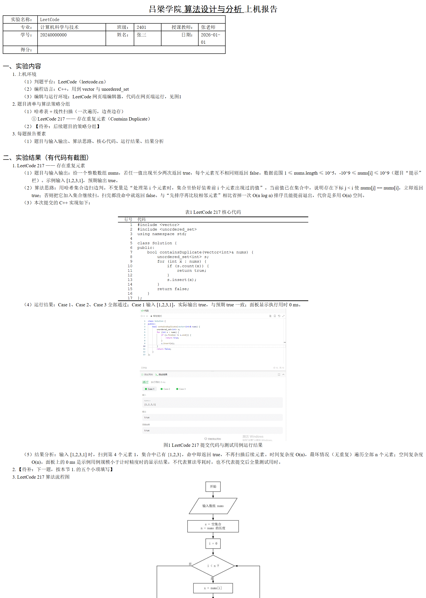

# lab-report

把课程**实验报告 / 上机报告**写成符合学校版式的 `.docx`：正文、四级编号、三线表代码、正交流程图、页脚页码全部由一份 JSON spec 生成。



## 它解决什么

- 编号（`一、` → `1.` → `（1）` → `①`）由脚本按层级生成，父项下自动重置，不会断号或叠加 Word 自动编号。
- 代码进三线表（`行号｜代码`，`Courier New`，无注释），表格宽度等于版心。
- 表题在表上方、图题在图下方，五号居中，按出现顺序编号。
- 正文中文宋体、西文与数字 Times New Roman，10.5 pt，1.5 倍行距。
- 流程图用 Graphviz `splines=ortho` 渲染，脚本当场审计：有曲线、斜线或圆角节点直接报错。
- 打包后用 Word 打开验证，再导出 PDF 数页、看字体，确认不是"看起来能开"。

## 环境要求

| 依赖 | 用途 |
|---|---|
| Windows + Microsoft Word（16 / Office 2016+） | 打开校验、导出 PDF、HTML 预览（COM 接口） |
| Node.js 18+ | 生成器与流程图脚本 |
| PowerShell 7（`pwsh`） | 解包 / 打包 docx |
| Microsoft Edge | 可选的 HTML 预览截图 |
| `npm install` | 装 `@viz-js/viz`（Graphviz 的 WASM 构建，不需要单独装 Graphviz） |

## 安装

把整个目录放进 skills 目录即可：

```text
Qoder:        ~/.qoder-cn/skills/lab-report
Claude Code:  ~/.claude/skills/lab-report
```

如果目录放在别处，可以建一个目录联接（Windows）：

```powershell
New-Item -ItemType Junction -Path "$env:USERPROFILE\.qoder-cn\skills\lab-report" -Target "D:\path\to\lab-report"
```

然后在该目录执行 `npm install`。

## 快速开始

```bash
npm install
node scripts/build-report.js -Spec examples/upper-report-leetcode217.json
# -> out/上机报告示例.docx
```

核验分页、表格与字体（会导出 PDF）：

```bash
pwsh -File scripts/verify-docx.ps1 -Docx out/上机报告示例.docx -Pdf out/预览.pdf
```

粗略看字形与缩进（导出 HTML 后截图，没有分页）：

```bash
pwsh -File scripts/render-html-preview.ps1 -Docx out/上机报告示例.docx -Png out/preview.png
```

## spec 怎么写

顶层字段：

| 字段 | 说明 |
|---|---|
| `template` | `upper-report`（三章上机报告）或 `ai-lab`（六章 AI 实验报告） |
| `out` | 输出路径，相对当前工作目录 |
| `cover` | 封面字段，键名与模板标签一致，脚本自己找同行空单元格填入 |
| `body` | 元素数组，按顺序排版 |

`body` 元素：

| 元素 | 作用 |
|---|---|
| `{"h1":"实验内容"}` | 一级标题，脚本加 `一、` |
| `{"item":[2,"上机环境"]}` | 二至四级条目，写层级和正文，不要手写编号 |
| `{"para":"..."}` | 无编号正文段 |
| `{"code":["..."],"label":"…如下：","caption":"LeetCode 217 核心代码"}` | 三线表代码；含注释会构建失败 |
| `{"table":{"caption","header","rows","widths?","align?"}}` | 普通三线表，表题在上 |
| `{"image":{"src","widthPt","caption"}}` | 嵌入图片，图题在下 |
| `{"flowchart":{"dot":"x.dot","widthPt":330,"caption":"图2 …","keepDot":true}}` | DOT 渲染并审计，可同时把 `.dot` 拷到输出目录 |
| `{"blank":true}` | 空行 |

素材路径（`src`、`dot`）写相对路径时，以 **spec 文件所在目录**为准。

## 目录

```text
SKILL.md                          agent 读取的入口与强制规则
references/format-upper-report.md 上机报告版式实测参数
references/format-ai-lab.md       AI 实验报告版式
scripts/build-report.js           spec -> docx
scripts/flowchart.mjs             DOT -> SVG/PNG + 几何审计
scripts/pack-docx.ps1             重打包 + XML 语法守卫 + Word 验开
scripts/verify-docx.ps1           页数、表格、字体、页脚核验
scripts/render-html-preview.ps1   HTML 预览截图
assets/                           两份模板 docx 与预览图
examples/                         可直接跑通的示例 spec、截图与 DOT
```

## 已知限制

- 只在 Windows + Word 16 实测；`pack-docx.ps1` / `verify-docx.ps1` 依赖 Word COM。
- HTML 预览没有分页，页数与表格宽度以导出的 PDF 和 twips 为准。
- 模板是特定学校的表格；换学校需要改 `references/format-*.md` 与 `assets/`。
- 流程图审计按"点/斜线/圆角"判定，装饰性图形会被拒绝，这是有意的。

## 来源与致谢

- 初始结构参考 [Candyu5120/ai-lab-report-skill](https://github.com/Candyu5120/ai-lab-report-skill)（上游未附 LICENSE）。
- 上机报告表格与 AI 实验报告模板来自课程材料，版权归原学校 / 课程所有；仓库中的脚本与文档可自由用于自己的课程报告。
